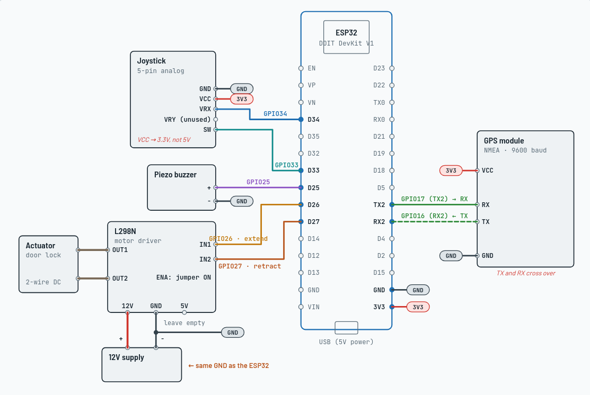

# Doublethink

An offline, standalone GPS alerter for pre-defined locations — built around
automated license plate reader (ALPR) / Flock Safety/Axon camera locations, but
the zone list is just coordinates, so it works for anything you want to be
notified about on approach. No cloud service, no account, no internet
connection required once it's flashed and loaded.

It runs entirely on an ESP32: reads GPS continuously, checks your position
against a locally-stored list of coordinates, and sounds an alert when
you're within a configurable radius of one. A second optional output — a relay-driven
actuator — fires once on entry and once on exit, wired up as a physical
"do something" trigger. What that something is is up to you: a visual
indicator, a gesture, or whatever else you want to build. The firmware just
gives you a signal to work with.

The GPS coordinates used come from OpenStreetMaps.org. They can be retrieved in
a ready to use JSON format at  https://noneya.page  were you can select just the city
or bounding box region you need coordinates from.  
The JSON is then uploaded to the esp32 so it knows when to notify you. 
The GPS module checks your current GPS coordinates constantly but never sends the
data anywhere,  it just checks it against the JSON file uploaded to look for matches. 
No GPS subscription is needed. Total cost for the project material was around $30. 

## Disclaimer

This project does not endorse, and is not designed for, modifications meant
to obscure, alter, or interfere with a vehicle's license plate or otherwise
evade law enforcement equipment — devices that do that are illegal in
nearly every US state, independent of this project. What you build with the
actuator output is your own responsibility. Separately, alerting on the
location of camera/law-enforcement equipment may itself be restricted in
your jurisdiction (comparable laws exist in some places for radar/laser
detectors) — check your local laws before using this in a vehicle.

This project's firmware was written with the assistance of Claude Code (Anthropic's AI coding tool). All hardware design, wiring, and testing were done on real hardware by hand. Review the code yourself before relying on it — AI-assisted code can still contain mistakes.

## Hardware

- ESP32 DoIt DevKit V1 (or any ESP32 dev board — adjust `platformio.ini`'s
  `board` if different)
- GPS module with NMEA output (UART)
- Piezo buzzer  (optional)
- A relay or motor-driver module (this was built and tested against an
  L298N driver, but any module driving two outputs works) + whatever
  actuator/output device you choose  (optional)
- Optional: a 2-axis analog joystick module (GND, VCC, VRX, VRY, SW) for
  manual control of the actuator output

### Bill of materials

Rough per-item prices from common listings — these move around and some
parts come in multi-packs, so treat this as a ballpark, not a quote:

| Component | Approx. price | Needed for |
|---|---|---|
| ESP32-WROOM-32 DevKit board | ~$9 | Core |
| GY-NEO6MV2 (NEO-6M) GPS module | ~$6 | Core |
| Passive piezo buzzer | ~$1 | Buzzer alert (optional) |
| L298N motor driver module (2-pack, ~$7) | ~$3.50/unit | Actuator output (optional) |
| Car door-lock actuator (2-pack, ~$14) | ~$7/unit | Actuator output (optional) |
| 2-axis analog joystick module (2-pack, ~$6) | ~$3/unit | Manual override (optional) |

Core build (ESP32 + GPS + buzzer) lands around $15-20; adding the full
actuator/joystick setup brings total material cost to roughly $30.

### Wiring



### Pin map (ESP32 DoIt DevKit V1)

| Function | Pin |
|---|---|
| GPS RX (module TX → here) | GPIO16 |
| GPS TX (module RX → here) | GPIO17 |
| Buzzer | GPIO25 |
| Actuator output A ("extend") | GPIO26 |
| Actuator output B ("retract") | GPIO27 |
| Joystick VRX (analog) | GPIO34 |
| Joystick SW (button, manual enable/disable) | GPIO33 |

Joystick VCC **must** be wired to the ESP32's 3.3V pin, not 5V — the ESP32's
ADC inputs are only rated to 3.3V, and a 5V-fed joystick can exceed that on
one side of its travel.

If you're using a relay board instead of an H-bridge driver, check whether
it's active-LOW or active-HIGH and set `RELAY_ACTIVE_LOW` in `src/main.cpp`
to match — a mismatch fires the output at exactly the wrong moments.

If your actuator has no built-in limit switches (most small DC gear-motor
actuators don't), it must be pulsed, not held — see `ACTUATOR_PULSE_MS` in
`src/main.cpp`. Holding power at the end of travel will stall and burn out
that kind of motor.

**Automotive wiring**: put an inline fuse close to whatever 12V source you
tap for the actuator circuit — a short in automotive wiring without one is
a fire risk. Size it to the wire gauge you're using and comfortably above
your actuator's actual draw, not a guess: measure the stall current
(multimeter, actuator physically blocked from moving — that's the worst
case) and pick the next standard fuse size up. As a rough starting point, a
**5A inline automotive blade fuse** covers most small door-lock-style
actuators on 18-20 AWG wire, but that's a starting point, not a substitute
for checking your own hardware — a bigger motor or thinner wire changes the
right number.

## Setup

1. Install [PlatformIO](https://platformio.org/) (CLI or the VS Code
   extension).
2. Copy `src/secrets.h.example` to `src/secrets.h` and set your own
   `AP_SSID`/`AP_PASSWORD`. This file is gitignored — it never gets
   committed, so your WiFi credentials stay local to your machine.
3. Build and flash:
   ```
   pio run -t upload
   ```
4. On boot, the ESP32 hosts its own WiFi access point using the credentials
   from `secrets.h`. Connect to it and browse to the IP address printed on
   Serial (115200 baud) to reach the settings/upload page.
5. Upload a `zones.json` (see **Zone file format** below) to replace the
   built-in placeholder zones. The alert radius is also adjustable from the
   same page, with no reflash needed.

The built-in default zones (used only until you upload your own list) are
placeholder coordinates at the geographic center of the contiguous US —
not real camera locations, just there so you can confirm the alert fires
before you've sourced real data.

## Zone file format

`zones.json` must be a JSON **array** of objects, each with numeric `lat`
and `lon` fields:

```json
[
  {"lat": 39.8283, "lon": -98.5795},
  {"lat": 39.8301, "lon": -98.5770}
]
```

Any other fields on an entry (`name`, `id`, `tags`, etc.) are parsed but
ignored, so it's safe to leave them in — what matters is the shape, not
what else is attached to each point. A top-level JSON *object* instead of
an array is rejected outright, even if coordinates are in there somewhere.
A bad or incompatible file fails safely: the upload is rejected and the
previous zone list stays active, nothing corrupts.

That means raw output from the Overpass API or a GeoJSON export won't work
as-is — both are objects at the top level, not arrays. Overpass responses
look like `{"elements": [{"type": "node", "lat": ..., "lon": ..., "tags":
{...}}, ...]}`; pull the `elements` array out and drop everything but
`lat`/`lon` per entry. A one-liner with `jq` does it:

```
jq '[.elements[] | {lat, lon}]' overpass_response.json > zones.json
```

This conversion is deliberately not done on the ESP32 — keeping the
firmware's job limited to GPS/alerting, not JSON wrangling, keeps it simple
and leaves its limited resources free for the real-time work. How you
source and convert your coordinate list is entirely up to you: your own
Overpass query, a GeoJSON export run through the snippet above, a
spreadsheet, or any other tool you trust. If you'd rather not bother
converting raw data yourself, https://noneya.page/ already outputs zone data in the
format this firmware expects — one option among several, not a requirement.

If you're using OpenStreetMap data, it's licensed under the **ODbL** — if
you redistribute a substantial extract, attribute OpenStreetMap
contributors and check the license's share-alike terms. Also be
considerate of the public Overpass API's fair-use limits if you query it
directly.

## Known limitations

- `/upload` and `/settings` have no authentication beyond knowing the WiFi
  password — anyone connected to the AP can change the zone list or alert
  radius. Fine for personal use; don't rely on it as a security boundary.
- `MAX_DANGER_ZONES` (currently 3000) is sized against measured heap usage
  during the JSON parse, not hardware-tested at the exact limit — a file
  that's too large fails safely (upload rejected, previous zones stay
  active) rather than corrupting anything.

## License

See `LICENSE`.
